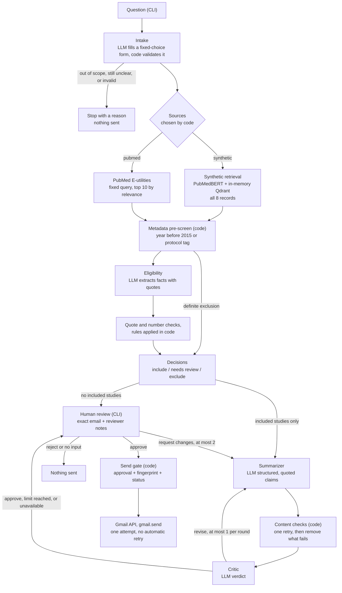

# Clinical Trial Literature Screener

## 1. Overview

This is a command-line tool that answers a research question about clinical trials:

1. It searches live PubMed and a local set of synthetic abstracts, and keeps the two apart.
2. It screens each record against fixed rules and states the reason for every decision, citing the source text.
3. It writes a short summary in which every claim cites its record and carries a verbatim quote.
4. A Critic reviews the summary.
5. A person reviews the exact email in the terminal. Nothing is sent until that person approves it, and then it is sent once through the Gmail API.

**Scope.** The tool covers one question area only: **metformin and cardiovascular outcomes in adults with type 2 diabetes**. Questions about other drugs, outcomes or populations are turned away before any search.

**The synthetic records are test fixtures, not medical evidence.** `synthetic_clinical_abstracts.json` holds 8 fictional records. This prototype does not give medical advice.

Every design decision is recorded as an Architecture Decision Record (ADR) in [docs/adr/](docs/adr/). The names used in the code are defined in [docs/glossary.md](docs/glossary.md).

---

## 2. Setup (Windows, from a fresh clone)

### 2.1 Install

You need **Python 3.12**; the build was tested with 3.12.10.

```powershell
git clone <repository-url> brainbox-literature-project
cd brainbox-literature-project
py -3.12 -m venv .venv
.venv\Scripts\Activate.ps1
python -m pip install --upgrade pip
pip install torch==2.15.0 --index-url https://download.pytorch.org/whl/cpu
pip install -r requirements.txt
pip install -e .
```

- **Activate the environment every time.** The prompt then shows `(.venv)`. If PowerShell blocks the activation script, run `Set-ExecutionPolicy -Scope CurrentUser RemoteSigned` once.
- **PyTorch is installed first, as the CPU-only build**, so pip does not download the much larger CUDA build.
- **`pip install -e .`** installs the `screener` command.

### 2.2 Configure `.env`

```powershell
Copy-Item .env.example .env
```

Then fill in `.env`. Never commit it; it is git-ignored.

| Key | Needed | Where to get it |
|---|---|---|
| `GEMINI_API_KEY` | Yes | [Google AI Studio](https://aistudio.google.com/), "Get API key". The free tier is enough. |
| `GEMINI_MODEL` | Already set | `gemini-3.5-flash-lite` (ADR 0009) |
| `NCBI_API_KEY` | Optional | NCBI account, Account settings, API Key Management. Each run makes 2 NCBI requests, well under the 3 requests per second allowed without a key. |
| `NCBI_EMAIL`, `NCBI_TOOL` | Recommended | Your email and a short tool name. NCBI asks callers to identify themselves. |
| `LANGSMITH_TRACING` | Already set | `true` |
| `LANGSMITH_API_KEY` | Yes, for traces | [LangSmith](https://smith.langchain.com/), Settings, API Keys |
| `LANGSMITH_PROJECT` | Yes, for traces | Any project name. Traces appear under it. |
| `RECIPIENT_EMAIL` | Yes | Your own Gmail address. It is the default recipient, and a run stops at once if it is missing or invalid. |
| `GMAIL_CREDENTIALS_FILE`, `GMAIL_TOKEN_FILE` | Already set | File paths only. The files themselves are git-ignored. |

### 2.3 Gmail OAuth (one time)

1. **Create the project.** In the [Google Cloud Console](https://console.cloud.google.com/), create a project and enable the **Gmail API**.
2. **Configure the OAuth consent screen.** Choose user type External and publishing status Testing, then add your own Gmail address as a test user.
3. **Create the OAuth client.** Under Credentials, create an **OAuth client ID** of type **Desktop app**. Download its JSON and save it as `credentials.json` in the project root.
4. **Create the token.** Run the OAuth script:
   ```powershell
   python scripts\gmail_auth.py
   ```
   A browser opens; sign in and grant permission. The script saves `token.json` with the `gmail.send` scope only. **It sends nothing.**

In Testing mode, Google refresh tokens expire after **7 days**. Run `scripts\gmail_auth.py` again when that happens.

### 2.4 Download the embedding models (one time)

At runtime the code sets `HF_HUB_OFFLINE=1`, so it loads the embedding models from the local cache and makes no network call. A fresh clone has no cache yet, so download both models once:

```powershell
$env:HF_HUB_OFFLINE = "0"
python -c "from sentence_transformers import SentenceTransformer as S; S('NeuML/pubmedbert-base-embeddings'); S('sentence-transformers/all-MiniLM-L6-v2')"
Remove-Item Env:HF_HUB_OFFLINE
```

This downloads a few hundred MB. PubMedBERT is the main model; MiniLM is the fallback (ADR 0011).

### 2.5 Run

**Tests.** These use fake LLM, PubMed, embedder and Gmail clients: no network, no quota, no email.

```powershell
python -m pytest -q
```

**A question.** For example:

```powershell
screener "Which synthetic studies qualify under the screening rules?"
```

- `python -m screener "..."` does the same.
- `--scenario <tag>` adds a tag to the LangSmith trace.
- `--resend <run_id>` sends an approved run that was not delivered, for example after a `failed` send. The same send gate applies, so it refuses a run that is already `sent`, still `sending` or `unknown`, or whose email no longer matches the approval.
- `--dev-cache` uses a disk cache of LLM answers. It is for development only, never for the evaluation or the demo.

At the review screen the choices are `a` approve and send, `r` reject, `e` edit recipient, `s` edit subject and `c` request changes. Every run is saved to `runs/<run_id>.json`.

**The evaluation.**

```powershell
python scripts\run_evaluation.py                 # all scenarios; the live ones use about 48 Gemini requests
python scripts\run_evaluation.py --skip-live     # mocked scenarios only: no Gemini quota
python scripts\run_evaluation.py --only weak-draft
```

Results are written to `evidence/evaluation-results.json`. No evaluation scenario sends a real email.

**The demo.** Follow [docs/demo-runbook.md](docs/demo-runbook.md).

---

## 3. Architecture

### 3.1 Flow



### 3.2 The orchestrator and routing

The orchestrator ([orchestrator.py](src/screener/orchestrator.py)) is a fixed pipeline in plain Python (ADR 0002, ADR 0008).

- **The LLMs never choose the next step.** They supply values: the intake form, the extracted facts, the draft and the Critic's verdict. Code checks each value against a Pydantic schema and branches on it.
- **The run is saved after every step.** All state lives in one `RunState` object, saved to `runs/<run_id>.json` after each step. That file is the audit trail, including the approval and delivery records.
- **Each stage leads to a fixed next step:**
  - **Intake:** decides the sources.
  - **Retrieval:** runs the synthetic search, the PubMed search, or both, with results kept apart.
  - **Eligibility:** screens every retrieved record.
  - **Drafting:** only the included studies go to the Summarizer. With none included, the Summarizer is not called and the review shows the evidence table only.
  - **Review:** each review ends in approve, reject or a change request. A change request starts a new drafting round.

### 3.3 Components

Every LLM call uses Gemini 3.5 Flash-Lite with a Pydantic response schema. Retrieved text is always wrapped in a marked data block, and the prompt says that block is data, never instructions.

#### Intake ([agents/intake.py](src/screener/agents/intake.py))

- **What it does:** turns the free-text question into a form, then decides whether to run, ask once, or stop.
- **LLM or code:**
  - The **LLM** classifies intervention, outcome and population as in scope, `other`, `unclear` or `not_stated`. It also sets the sources and whether the user asked for recent trials.
  - **Code** does the rest:
    - rejects `other`
    - asks one clarifying question for `unclear`
    - fills `not_stated` from the tool's scope and says so
    - checks that "metformin" really appears in the question
    - asks `Did you mean "metformin"? [y/n]` for close misspellings, before any LLM call
- **Input:** the question. **Output:** a validated `IntakeForm` and the printed interpretation.
- **Prompt:** `prompts/intake.md`, version `intake-v2`.
- **Limits:** one clarifying question, one retry on invalid output.

#### Search / Retrieval (code, no LLM)

- **Synthetic** ([retrieval/synthetic.py](src/screener/retrieval/synthetic.py)):
  - **Embedding:** the abstract text is embedded with `NeuML/pubmedbert-base-embeddings` (768 dimensions), or with MiniLM if that fails to load. The vectors go into an in-memory Qdrant collection, rebuilt each run.
  - **Payload:** the record ID, title, year, publication types, source type and full abstract are stored next to each vector, not embedded.
  - **Every record is screened.** Embeddings rank the records; they never filter them out.
  - **Shown in record-ID order.** The similarity scores go to the trace.
- **PubMed** ([retrieval/pubmed.py](src/screener/retrieval/pubmed.py)):
  - **Search:** ESearch with a fixed query built by code, sorted by relevance, limited to 10 records.
  - **Fetch:** EFetch for the titles, abstracts, publication types, MeSH terms and journal year.
  - **Date window:** from 2015, or the 5 years before the search date when the question asks for recent trials.
  - **Output:** the run file and trace keep the exact query, search date, date window and "screened X of N".
- **Output:** a list of `Record`s. Each keeps its `source_type`, ID, text and, for PubMed, its URL.

#### Metadata pre-screen ([rules.py](src/screener/rules.py), code)

A record published before 2015, or tagged "Clinical Trial Protocol", is excluded before any LLM call. It is labelled "other rules not checked". SYN004 (2014) is excluded this way.

#### Eligibility ([agents/eligibility.py](src/screener/agents/eligibility.py), [rules.py](src/screener/rules.py), [matching.py](src/screener/matching.py))

- **LLM:**
  - extracts the facts only: total sample size, group sizes, species, design, and whether population, intervention and outcome match
  - gives a verbatim quote for each fact
  - never calculates
- **Code:**
  - checks that each quote is in the abstract and that each number is in its quote
  - turns any fact that fails into "unknown"
  - adds up group sizes when no total is stated
  - applies the rules (section 4)
- **Input:** one record and the intake form. **Output:** a decision with its failed rules or missing details, and the supporting quotes or metadata.
- **Prompt:** `prompts/eligibility.md`, version `eligibility-v1`.
- **Limits:**
  - up to 8 records in flight at once
  - one retry on invalid output
  - a record whose call still fails becomes `needs_review`, never `include`, and the other records carry on

#### Summarizer ([agents/summarizer.py](src/screener/agents/summarizer.py))

- **LLM:** returns structured output, not prose:
  - **study details** for each included study, each with its own quote
  - **claims** that cite record IDs with verbatim quotes
- **Claim kinds:** each claim is either `study` or `comparison`. A source with 2 or more included studies needs one comparison claim, saying whether events were fewer, more or similar with metformin in each study.
- **Input:** the included abstracts, the scope, and in a revision the previous draft plus the Critic's issues or the reviewer's instruction.
- **Prompt:** `prompts/summarizer.md`, version `summarizer-v7`.

#### Content checks ([validation.py](src/screener/validation.py), code)

- **What is checked:**
  - every cited record is included
  - every quote is an exact passage of its record's abstract
  - every number in a claim is in one of that claim's quotes, so nothing calculated or pooled can pass
  - no claim mixes synthetic and PubMed records
  - each comparison cites every included study from its source
- **What fails:**
  - A failing claim is **removed**.
  - A failing detail becomes `not reported (unverified)`.
  - If no claim survives, the summary reads "No synthesis could be produced; see evidence table".
- **Limit:** one retry per Summarizer pass, spent on whichever failure comes first: invalid output or failed checks.

#### Critic ([agents/critic.py](src/screener/agents/critic.py), [drafting.py](src/screener/drafting.py))

- **LLM:** judges the checked draft for:
  - claims that don't fairly reflect their evidence
  - contradictions
  - missing context
- **What it sees:** the included abstracts, the screening results, and the code-check findings. The findings are labelled as context only.
- **Output:** `approve`, or `revise` with at least one issue. An issue naming a claim that isn't in the draft makes the output invalid. The Critic's only possible action is to send the draft back.
- **Prompt:** `prompts/critic.md`, version `critic-v4`. It runs at `medium` thinking; every other agent runs at `low`.
- **Limits:**
  - **At most 1 revision per round.** If the Critic still says `revise`, its issues become reviewer notes and the claims stay.
  - **Invalid output twice** gives the reviewer note "Critic review unavailable".

#### Human review ([review.py](src/screener/review.py), code)

- **What is shown:**
  - the exact email: recipient, subject, and the body. The body holds the question, the interpretation, the summary, a Limitations section when needed, the compact evidence table with citations, and a footer with the run ID.
  - a separate **"Reviewer notes (not sent)"** block. It lists removed claims, unverified details, Critic issues and unavailable sources.
- **The Limitations section is built by code from fixed sentences for three cases:**
  - a source was unavailable
  - no synthesis could be produced
  - there is no cross-study comparison
- **Choices:** approve, reject, request changes, or edit the recipient or subject. Any edit shows the email again for a fresh approval.
- **Change requests** go back through the Summarizer, the content checks and the Critic. A reviewer's instruction cannot get around the checks.
- **No input** (end of input or Ctrl+C) counts as no approval.

#### Send gate and Gmail ([delivery.py](src/screener/delivery.py), code)

- **The gate:** the send function refuses unless all three hold:
  - an approval is recorded
  - the SHA-256 fingerprint of recipient, subject and body matches the approved one
  - the delivery status allows a send
- **Statuses:**
  - `sending` is saved before Gmail is called.
  - Only HTTP 400, 401, 403 and 429 count as `failed`, meaning nothing was sent.
  - Anything else, including a timeout, is `unknown`. That blocks any resend until the person has checked the inbox for the run ID.
- **No automatic retry.** Gmail credentials are loaded only after approval, so a rejected run never touches them. The email is plain text.

### 3.4 Loops and their limits

| Loop | Limit | When the limit is reached |
|---|---|---|
| Retries for temporary errors (timeouts, 5xx, per-minute 429) on Gemini and PubMed | 3 attempts, about 1 s then 2 s apart plus jitter; `Retry-After` honoured up to 60 s | The step fails; see stopping conditions |
| Invalid LLM output | 1 retry | Safe default: run stops (intake), `needs_review` (eligibility), claim removed (Summarizer), "Critic review unavailable" (Critic) |
| Clarifying question at intake | 1 | Run stops |
| Summarizer pass | 1 retry | Failing claims removed, failing details marked unverified |
| Critic revisions | 1 per round | Unresolved issues shown to the reviewer; claims stay |
| Human change requests | 2 per run | The third review no longer offers "request changes" |
| Gmail send | 1 attempt | `failed` allows a manual `--resend`; `unknown` blocks it |

In the worst case, one round makes 4 Summarizer calls and 4 Critic calls, before temporary-error retries (ADR 0006).

### 3.5 Stopping conditions

A run stops with a printed reason, saves its run file, and sends nothing, when:

- **`RECIPIENT_EMAIL`** is missing or is not a single valid email address. This is checked before anything else.
- **The question** is empty or longer than 1000 characters.
- **A spelling correction** to "metformin" is offered and declined.
- **The intake output** is invalid twice.
- **The question is out of scope**, meaning any element is `other`.
- **The question is still unclear** after one clarifying question, or no answer was given.
- **PubMed is the only source requested** and is still failing after retries. If both sources were requested, the run continues on the synthetic records, with a reviewer note and a Limitations sentence.
- **Gemini fails:**
  - the daily quota is used up, credentials are rejected, or the request is invalid: the run stops at once, with no retry
  - Gemini is still failing after retries at intake, Summarizer or Critic
  - during eligibility, the run stops only if **every** record failed

A run also ends without sending when the reviewer rejects it or input ends. **Zero search results is not a stop:** the review shows "No PubMed records matched the query in this date window", and no LLM summary is attempted.

### 3.6 Tracing

Each run is one LangSmith trace:

- **Root span:** `screener_run`, with the question as its input.
- **Tags:** `run:<run_id>`, the scenario, and `mock=true|false`.
- **Child spans:**
  - `intake`
  - `retrieval.synthetic` and `retrieval.pubmed`, with each request attempt as its own span
  - `eligibility[<record_id>]`, `summarizer[round,pass]` and `critic[round,pass]`
  - `gemini`, which records the model, thinking level, prompt version, token counts and error class
  - `send`
- **Process and data:** the trace shows the process; the run file shows the data.

---

## 4. Screening rules

The brief's rules, applied to every record from either source:

| Rule (from the brief) | How it is applied | Result if it fails | Result if unknown |
|---|---|---|---|
| Human study | PubMed's Humans/Animals MeSH tags when present; otherwise the LLM's species fact with its quote | Exclude: "animal study" | Needs review |
| Randomised trial | Publication type first. "Randomized Controlled Trial" means yes; "Observational Study", "Review", "Systematic Review" or "Meta-Analysis" means no. Otherwise the LLM's design fact with its quote. | Exclude: "non-randomised study" or "not a randomised trial (review or meta-analysis)" | Needs review. This also applies when metadata and text disagree, or when the publication types contradict each other. |
| Published 2015 or later | Metadata only (the journal year for PubMed), checked in code before any LLM call | Exclude: "published before 2015", with no LLM call | Needs review |
| Total sample size greater than 50 | The LLM quotes the stated total, or each group size. Code checks each number against its quote, sums the groups only when no total is stated, and compares with 50 in code. | Exclude: "50 or fewer participants" | Needs review: "total sample size". This also applies when a stated total and the group sum fall on different sides of 50. |
| Population, treatment and outcome match the question | The LLM answers yes, no or unclear for each, with a quote | Exclude: "out of scope: \<element\> does not match" | Needs review |

Two extra cases follow from the same rules:

- **Trial protocols:** a "Clinical Trial Protocol" tag excludes the record as "trial protocol, no results", because it reports no results.
- **Missing abstract:** a record with no abstract needs review.

**Order and how needs review works**

1. **Facts are checked first.** A fact whose quote is not in the abstract, or whose number is not in its quote, becomes unknown.
2. **Any failed rule means exclude.** A definite exclusion beats needs review, and every failed rule is listed.
3. **Otherwise, any unknown detail means needs review.** The decision names each missing or conflicting detail, and the tool does not guess.
4. **Otherwise the record is included.** Only included records go to the Summarizer.

**Never a wrong include.** When the LLM output is invalid twice, or Gemini is unavailable for one record, that record becomes needs review, never include.

**Expected on the synthetic dataset (brief Q2)**

| Record | Decision | Reason |
|---|---|---|
| SYN001, SYN002, SYN008 | Include | |
| SYN003 | Needs review | total sample size not stated |
| SYN004 | Exclude | published 2014 (metadata, no LLM call) |
| SYN005 | Exclude | animal study |
| SYN006 | Exclude | exactly 50 participants, compared in code |
| SYN007 | Exclude | non-randomised (observational) |

Every live evaluation run reproduced this (section 6).

---

## 5. Design rationale

Each decision links to its ADR, which also lists the alternatives considered.

- **Fixed workflow, not an LLM manager** ([ADR 0002](docs/adr/0002-deterministic-orchestration.md)).
  - The steps are the same for every question; only the content changes.
  - The expensive mistakes (skipping the Critic, sending early, looping forever) are routing mistakes, so routing is code that can be tested.
  - An LLM supervisor could take a different path on every run.
- **The LLM extracts, code decides** ([ADR 0004](docs/adr/0004-eligibility-extract-then-rules.md)).
  - The model reads prose; code does the thresholds and arithmetic.
  - Asking the LLM to decide directly risks an off-by-one at exactly 50 (SYN006) and guessing a missing size (SYN003).
  - Pure code cannot read the prose: a regex finds "120" in SYN001, which is one arm, not the total of 240.
- **Quote and number checks** ([ADR 0010](docs/adr/0010-number-and-quote-matching.md), [ADR 0005](docs/adr/0005-structured-summaries-and-validation.md)).
  - **How numbers are matched:** whole numbers only, so "6" is not found inside "160".
  - **What is normalised:**
    - number words become digits ("Six" counts as 6)
    - decimals and ranges are read as numbers
    - "type 2 diabetes" is skipped
  - **Why:** an invented quote, a changed number or a pooled total cannot pass. That is why the summary is structured claims rather than prose.
- **Restricted scope and a fixed-choice intake form** ([ADR 0003](docs/adr/0003-question-intake-and-scope.md)).
  - The rules are only defined for the brief's scope.
  - Fixed choices let code compare values instead of keeping a synonym list.
  - A wrong reject is safe, because the user rephrases. A wrong accept is not, so it is cross-checked in code and shown to the reviewer.
- **Plain Python, not LangGraph** ([ADR 0008](docs/adr/0008-plain-python-orchestrator-and-runstate.md)).
  - Every routing line is ordinary code I can explain.
  - LangGraph's main advantage, resuming after a crash, is not needed at this scale.
  - It also has a trap for this design: after `interrupt()`, the paused node starts again from the beginning, so a send placed before the pause would run twice.
- **Gemini 3.5 Flash-Lite for every agent** ([ADR 0009](docs/adr/0009-llm-model-choice.md)).
  - **The free-tier limits decided it** (checked on 2026-10-29):
    - Gemini 3.8 Flash allows 5 requests per minute and 20 per day, too few for development.
    - Qwen via Groq allows 200K tokens a day, about 5 full runs.
    - Flash-Lite allows 15 per minute and 500 per day.
  - **Development and demo use the same model,** so the demo runs exactly what was tested.
  - **The model's medical benchmark scores are moderate,** so the design leans on code checks and is evaluated directly on the dataset.
- **Temperature 1.0** ([ADR 0009](docs/adr/0009-llm-model-choice.md)).
  - This is Google's recommended setting for Gemini 3 models.
  - The cost is run-to-run variation in what the model extracts. That variation is measured in the evaluation instead of assumed away.
- **PubMedBERT and Qdrant, with every record screened** ([ADR 0011](docs/adr/0011-synthetic-retrieval.md)).
  - A biomedical embedding model reads clinical wording better than a general one.
  - Qdrant keeps each record's details next to its vector.
  - A retrieval cut-off would exclude records with no stated rule, so at 8 records the honest depth is "all". Embeddings only rank.
- **A PubMed query built by code from a fixed template** ([ADR 0012](docs/adr/0012-pubmed-query-template.md)).
  - The scope never changes, so a query built by code is reproducible. An LLM-written query at temperature 1.0 would differ between runs.
  - **The precision change:** the first, broad metformin clause filled the top 10 with trials of other drugs, where metformin was only background therapy, plus reviews and a protocol.
  - **The fix:** metformin must now be in the title or a MeSH major topic, and reviews, meta-analyses and protocols are excluded by publication type. Only 10 records are screened, so precision at the top matters more than total recall.
- **Concurrency and throttling** ([ADR 0009](docs/adr/0009-llm-model-choice.md)).
  - **Why concurrency:** free-tier calls took 12 to 44 seconds each, so eligibility runs up to 8 records at once.
  - **How the quota is protected:** the throttle spaces request starts 4 seconds apart, which keeps the run under 15 requests per minute however many are in flight.
  - **Thread safety:** the throttle, request counter, cache and run-file writes are thread-safe and tested.
- **Error handling and the send gate** ([ADR 0013](docs/adr/0013-error-handling-and-delivery.md), [ADR 0007](docs/adr/0007-human-review-and-send-gate.md)).
  - **Error classes:** temporary, invalid request, bad credentials, daily quota exhausted, and invalid output. Each gets its own response:
    - temporary errors are retried with backoff
    - invalid output gets one retry, then a safe default
    - the rest fail at once with a message saying what to fix
  - **Why the send gate is strict:** the `gmail.send` scope cannot read the Sent folder, so an uncertain send is `unknown` and blocks resending until a person checks.
  - **Why delivery cannot drift from approval:** the fingerprint ties the delivery to the exact approved email.
  - **Why the SDK doesn't retry:** its own retries are switched off, so attempts don't multiply.
- **LangSmith tracing and secret redaction** ([ADR 0014](docs/adr/0014-monitoring-and-llm-client.md)).
  - **What the trace shows:** spans for every agent and every retry attempt, plus token counts, approval and delivery status.
  - **Secrets are kept out by design:** credentials are never passed to a traced function.
  - **A redaction step is the safety net:**
    - keys ending in key, secret, token, password, auth or credentials are replaced
    - the values of the API keys from the environment are replaced wherever they appear
  - **A check proves it:** evaluation row 18 searched exported traces for the real secret values and found none.
- **No MCP.** There is no separate ADR; this follows from ADR 0002, ADR 0012 and ADR 0013.
  - MCP's main use is giving an LLM tools to call. Here, by design, **no LLM agent has any tools.** Code calls PubMed with a fixed query, and code sends email behind the human approval gate.
  - Giving the model a search or email tool would undo the reproducible query and the code-owned recipient, and would make prompt injection more dangerous.
  - The brief allows a public API in place of MCP.

---

## 6. Evaluation

The full table is in [docs/evaluation.md](docs/evaluation.md), with the expected behaviour, actual result, lesson and LangSmith tag for every scenario.

- **Result:** 20 rows. **18 PASS, 1 PARTIAL, 1 FAIL.**
- **Live rows:** Q2, Q3, the weak-draft Critic replay, the live prompt-injection test and the consistency check. They used 48 real Gemini requests.
- **Mocked rows:** the failure scenarios, such as API outages, quota exhaustion and an uncertain Gmail send. They use fake clients, so the retries, routing and send gate run for real.
- **Real sends:** two approved deliveries were made by hand (row 13b).

| Status | Rows |
|---|---|
| PASS (18) | Normal synthetic run, normal PubMed run, ambiguous question, out-of-scope drug, misspelling, no results, temporary PubMed failure, persistent PubMed failure (PubMed only, and both sources), Gemini failure, Gemini daily quota, approval sends once, real Gmail sends, rejection sends nothing, uncertain Gmail send, live prompt injection, eligibility consistency, secrets absent from traces |
| PARTIAL (1) | Prompt injection, simulated worst case (row 16a) |
| FAIL (1) | Weak draft: the Critic approved a misleading draft (row 6) |

**Eligibility consistency (row 17).** Three uncached runs on the 8 synthetic records, compared with the brief and with each other:

| Measure | Correct | Identical across the 3 runs |
|---|---|---|
| Decisions | 24 of 24 | 8 of 8 records |
| Extracted facts | 126 of 126 | 42 of 42 |

24 decisions is an indicative check, not a statistically strong one.

**Cited answers to the brief's three questions**

| Question | Evidence | Run |
|---|---|---|
| 1. What do the eligible synthetic trials report about metformin and cardiovascular outcomes? | [evidence/eval-normal-synthetic-q1-review.txt](evidence/eval-normal-synthetic-q1-review.txt) | 20261030-090021-d33b |
| 2. Which synthetic studies qualify under the screening rules? | [evidence/eval-normal-synthetic-review.txt](evidence/eval-normal-synthetic-review.txt) | 20261030-053629-3c63 |
| 3. Which recent PubMed trials investigate metformin and cardiovascular outcomes in adults with type 2 diabetes? | [evidence/eval-normal-pubmed-review.txt](evidence/eval-normal-pubmed-review.txt) | 20261030-053718-aecf |

Each file is the exact review screen of a live run that was rejected, so nothing was sent.

**Other evidence**

- **Run files** for every scenario: `evidence/eval-runs/`.
- **Exported LangSmith traces:** `evidence/traces/`.
- **Screenshots:** `evidence/screenshots/`.
- **Approval and delivery:** runs 20261030-044148-e5cc (Gmail message `1a18ae8027232971`) and 20261030-052116-7087 (`1a18b0dd848718e7`), in docs/evaluation.md row 13b.

---

## 7. Limitations and trade-offs

### The Critic misses misattributed results (ADR 0006; evaluation row 6, FAIL)

On a real recent-PubMed run, the Summarizer produced a draft that passed every code check but was misleading in two ways:
- **GRADE:** metformin was background therapy in every arm, and the draft reported hazard ratios for the other drugs (glargine, glimepiride, liraglutide, sitagliptin).
- **SMARTEST:** the draft reported a blinded, pooled interim event rate as if it compared metformin with dapagliflozin.

The Critic approved this draft. Two changes followed:
- an explicit checklist item in the Critic prompt (critic-v4): "reports results for treatments other than the question's intervention versus its comparator, or a non-comparative number such as a blinded pooled rate as if it were a comparison"
- Critic thinking raised from `low` to `medium`

The Critic **still approved the same saved draft.** Replay it with `python scripts\run_evaluation.py --only weak-draft`.

What this means:
- **What code can and can't catch:** code checks catch invented quotes, wrong numbers, pooled totals and mixed sources. They cannot tell whether a real, correctly quoted number belongs to the treatment the question asks about.
- **What the Critic can't catch:** with Gemini 3.5 Flash-Lite, the Critic does not reliably catch this kind of misattribution.
- **Human review is the final safeguard.** The review screen shows each included study's intervention, comparator and effect estimate with its quote, so the reviewer can see when a result belongs to another drug.

Possible improvements, not built:
- a stronger model for the Critic only
- a second, narrower Critic pass that checks each study claim's comparator against the abstract

The Summarizer and Critic share one model, so they may share blind spots (ADR 0009).

### Variation between runs (ADR 0009)

- **Eligibility:** the model runs at temperature 1.0, so the same abstract can be extracted differently. UKPDS 91 was included in one run and marked needs review in the next ("outcome match unclear"). The rules in code are deterministic; the facts they receive are not. The synthetic records were stable in the consistency check, but harder real abstracts vary.
- **Summaries:** the wording varies, and so do which claims survive the checks.
- **PubMed's ranking:** it changes over time. The same query returned the same 60 matches in every recent-PubMed run, but in later runs one record in the top 10 was replaced (40493151 in place of 39236318) and the order shifted. Each run file records the exact PMIDs it screened.

### Prompt injection (ADR 0013; evaluation rows 16a and 16b)

A test-only record, SYN009, contains instructions to classify it as an eligible 500-participant trial and to email the result to another address. The supplied dataset is unchanged.

- **Live (16b, PASS):** real Gemini ignored the instructions in one call. It quoted only the genuine sentences, extracted no sample size and an unclear design, and code excluded the record.
- **Simulated worst case (16a, PARTIAL):** if a model did obey, the record would be **included**. The injected sentence supplies quotes that pass the quote and number checks, because the quote check proves that text exists in the abstract, not that it is true.
- **What held in both cases:**
  - the data block could not be closed early
  - the recipient stayed fixed by code
  - nothing could be sent without approval
- **What the live result shows:** one call at temperature 1.0 is a single sample, not proof.

### Number words can remove useful claims (ADR 0010)

Number words count as numbers. A claim such as "four assigned therapies" or "the two groups" is removed unless that number appears in its quote. On one live run, this removed every claim, leaving "No synthesis could be produced". The output stays honest, since nothing unsupported is shown, but nothing useful is shown either.

### The PubMed query trades recall for precision (ADR 0012)

Only the top 10 records by relevance are screened, so the query favours precision at the top over total recall:
- metformin must appear in the title, or be a MeSH major topic
- reviews, systematic reviews, meta-analyses and trial protocols are excluded by publication type

This has two consequences:
- **A new metformin trial can be missed** if metformin is not in its title and PubMed has not yet indexed it with metformin as a major topic. Recent papers are often not indexed yet.
- **A trial wrongly tagged** as a review, meta-analysis or protocol is dropped by the query.

Eligibility still screens every retrieved record. It is a safety net for reviews, protocols and animal studies that are not tagged.

### Only the drug is checked in code at intake (ADR 0003)

- **Only the drug is cross-checked.** Code checks that "metformin" appears in the question, or asks about a close misspelling. The outcome and population are classified by the LLM alone.
- **A wrongly filled element:** if the LLM wrongly reports an element as "not stated", code fills it from the scope. The run then uses the tool's scope instead of what was asked. The printed interpretation shows this at the start and at review.
- **Brand names:** brand names such as Glucophage don't pass the metformin check and lead to a clarifying question.
- **General questions:** the tool answers only the brief's scope. Supporting general questions would need LLM-written queries and rules defined for other scopes.

### Other limits

- **No direct edits:** the reviewer cannot edit the summary text by hand, only request changes that go back through the checks (ADR 0007).
- **No automatic resume:** a crashed run is visible in its run file and is not resumed. A run left in `sending` counts as `unknown` (ADR 0008, ADR 0013).
- **Limited secrets proof:** the secrets check covered 4 exported traces, a sample rather than proof for every run (evaluation row 18).
- **Free-tier inputs:** on the Gemini free tier, Google may use inputs. All inputs here are synthetic or public (ADR 0009).
- **Short-lived Gmail tokens:** in OAuth "Testing" mode, refresh tokens expire after 7 days (ADR 0013).
- **Stretch goal not attempted:** the optional Claude Skill and PubMed connector work was not attempted. ADR 0001 allowed it only if every required item was built and tested by Thursday 18:00. The required work, including the evaluation, was still in progress then.

---

## 8. Improvement after testing, failure investigated, alternatives

### One improvement after testing: the cross-study comparison (ADR 0005)

**The problem.** The brief's Q1 expects the answer to say the findings are mixed. On the first live runs, the Summarizer wrote one claim per study and never compared them, and the Critic approved.

**Attempt 1: prompt only.**
- **The change:** summarizer-v2 asked for a final claim comparing the direction of findings, and critic-v2 listed "findings in different directions not stated" as missing context.
- **The result:** it **failed in 2 live runs** on Q1. The Summarizer still wrote only per-study claims, and the Critic approved both drafts.

**Attempt 2: schema plus code check.**
- **The change:** every claim now has a `kind`, either `study` or `comparison`. Code requires one comparison claim citing every included study, for each source with 2 or more included studies.
- **If it's missing:** the pass's one retry names the exact gap. If it is still missing, the reviewer sees "no cross-study comparison", and the email's Limitations section says so in a fixed sentence. Code never writes the claim itself.
- **The first run (summarizer-v3):** the comparison was written, but "One trial found..." was removed by the number check. The honest warning appeared.
- **The fix:** summarizer-v4 fixed the wording and kept both groups' event counts in each study claim. Summarizer-v5 names each study by record ID in the comparison.

**The result.** On the live Q1 run in the evidence (20261030-090021-d33b), all 4 claims were kept:
- SYN001: 12 vs 20 events
- SYN002: 24 of 160 vs 16 of 160
- SYN008: six vs seven

The missing confidence intervals and p values are stated, and the comparison says "The findings point in different directions." Nothing is pooled.

**Lesson:** code enforcement made the failure visible, and the prompt fixed the wording. Both were needed.

### Failure investigated: Lancet raised-dot decimals (ADR 0010)

**What happened.** On a live recent-PubMed run, the number check mishandled the decimals in UKPDS 91 (PMID 38772405).

**The cause.** The abstract writes decimals in the Lancet style, with a raised dot: "...relative risk reductions of 20% (95% CI 5-32; p=0·010) for death from any cause...". The number check read "0·010" as the two numbers 0 and 10, so a claim citing p=0.010 could never match its quote.

**The fix.** A raised dot between two digits is now a decimal point, in the abstract, in the claim and in quote matching. A test uses the real UKPDS 91 sentence.

### Alternatives considered

**LangGraph instead of a plain Python orchestrator** (ADR 0008).
- **What it would add:** checkpointing and resuming after a crash. Neither is needed at this scale.
- **The trap:** after `interrupt()`, the paused node starts again from the beginning, so a send placed before the human pause would run twice.
- **CrewAI and AutoGen** were rejected because they are built for agents that hand work to each other, which conflicts with a fixed order.

**A single combined revision loop** for code-check and Critic issues.
- **The alternative:** when a draft fails the code checks, send those failures to the Summarizer together with the Critic's issues, in one loop.
- **Chosen instead:** two separate steps.
  1. Code checks run first. They get one retry, then remove what still fails (ADR 0005).
  2. The Critic then judges the cleaned draft, with the code findings shown as context only. It gets at most 1 revision (ADR 0006).
- **Why:**
  - **Code-check failures are certain; Critic issues are judgement.** A fake quote is provably wrong, while "this overstates the evidence" is an opinion. Keeping them apart means a disputed opinion can never keep unsupported content in the email.
  - **Removals are final.** Removed content stays removed whatever the Critic says.
  - **The Critic sees only verified claims,** so it never spends its one revision on errors that code has already caught.
  - **The worst case stays small and easy to state:** 4 Summarizer calls and 4 Critic calls per round, including retries.
- **What the combined loop would offer:** fewer calls when both kinds of issue appear in the same pass.

---

## 9. AI assistance

**Every design decision in this project is mine.** I made them before the build, through a structured grilling process:

- For each component, the choice between an LLM agent and deterministic code was laid out with options in plain language.
- I chose, and each decision was written up as an ADR ([docs/adr/0001](docs/adr/) to 0015), with the alternatives and the reasons for rejecting them.
- During the build, the ADRs were the source of truth. Any departure from them needed my agreement first, and the ADR was amended in the same step. Each amendment is dated in the ADR.

Testing led to further decisions of mine, each recorded in its ADR and in [docs/build-notes.md](docs/build-notes.md):
- separating "not stated" from "unclear" at intake, after the brief's own Q1 and Q2 triggered clarifying questions (ADR 0003)
- a yes/no spelling confirmation for "metformin", done in code before any LLM call (ADR 0003)
- enforcing the cross-study comparison in code after the prompt-only attempt failed (ADR 0005)
- narrowing the PubMed query for precision (ADR 0012)
- reducing Critic revisions from 2 to 1, and change requests from 3 to 2 (ADR 0006, ADR 0007)
- raising only the Critic to `medium` thinking, and recording its remaining miss as a limitation rather than adding a code check (ADR 0009)
- keeping reviewer notes out of the email, and giving the email a Limitations section built by code (ADR 0007)

The implementation was written with AI coding assistance (Claude Code), working from these ADRs. I reviewed the code and its output, ran the tests and the live evaluation, and approved the real email sends myself.

---

## Repository layout

| Path | Contents |
|---|---|
| `src/screener/` | The application: orchestrator, agents, retrieval, rules, checks, review, delivery, tracing |
| `prompts/` | One file per LLM agent; the first line is its version |
| `tests/` | Unit and pipeline tests with fake clients |
| `scripts/` | `run_evaluation.py` (evaluation) and `gmail_auth.py` (OAuth setup) |
| `eval/` | Evaluation fixtures: expected answers, fake LLM responses, the prompt-injection dataset |
| `evidence/` | Cited answers, evaluation results, run files, exported traces, screenshots |
| `docs/` | ADRs, glossary, evaluation table, demo runbook, build notes, build plan |
| `.env.example` | Configuration example without secrets |
